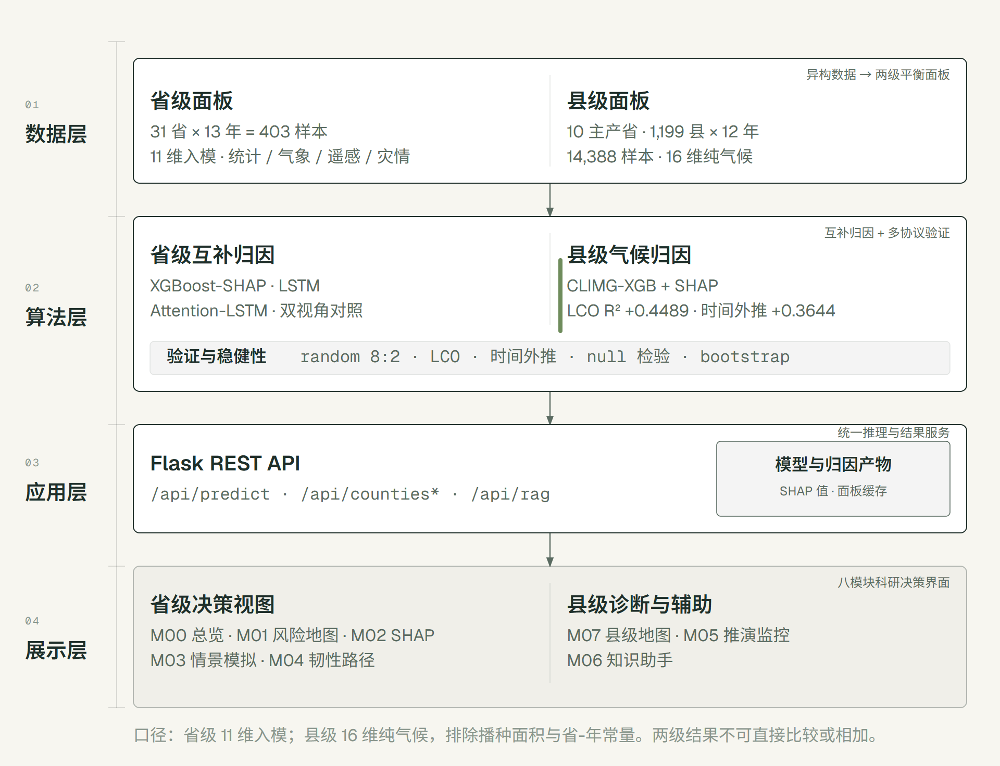
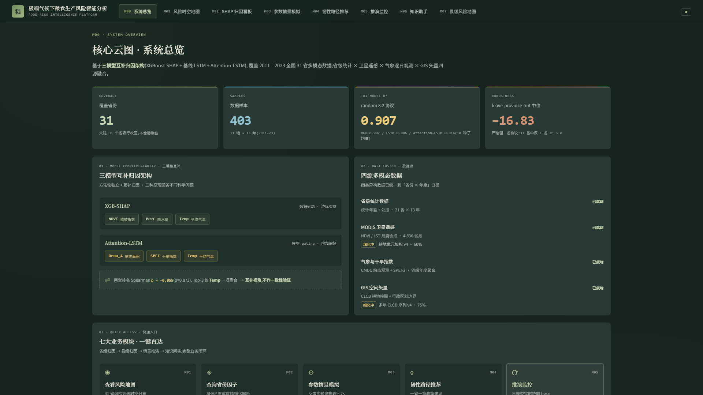
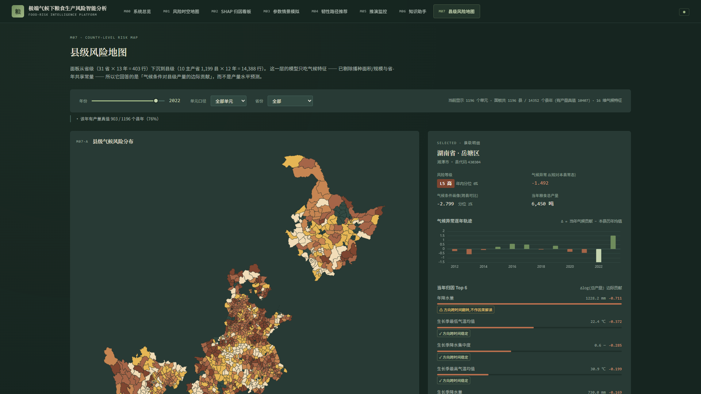
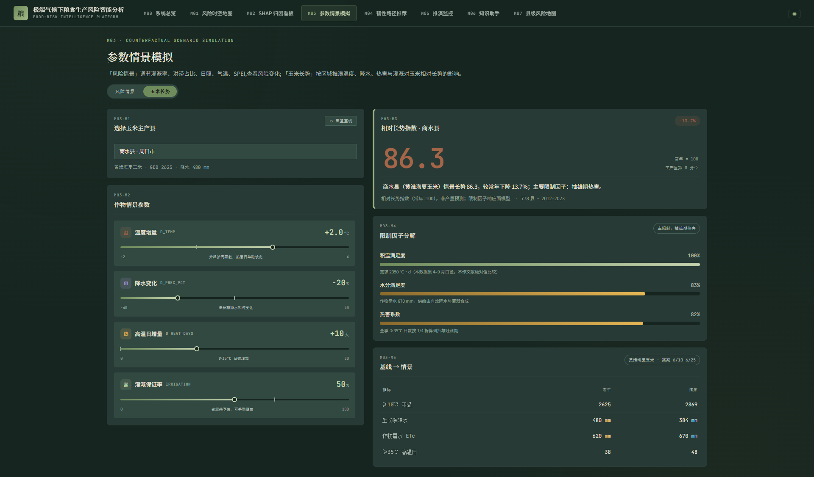
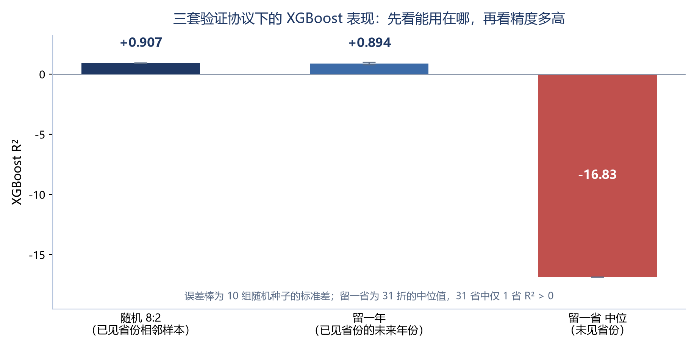

# 禾衡·粮食生产气候风险归因决策系统

> 〔作者备注〕**提交格式**：本文件定稿后导出 PDF（≤10 MB）。
> **匿名要求**：全文不得出现所在学校名称、Logo、院系名称与指导教师信息（已在初稿阶段全部清除）。
> **数字口径**：严格遵循项目稳健性红线，所有 R² 均标注协议来源，不作跨协议混用。

---

## 一、项目概述

### 1. 背景与意义

**学科背景。** 极端气候已成为粮食安全的核心扰动源。2023 年全国平均气温创 1961 年以来新高，京津冀"23·7"极端暴雨致河北平原约 24 万公顷农田受灾，长江中下游高温干旱与西南"旱涝急转"叠加发生。在农学与农业气象学的学科视野中，这类事件提出的核心科学问题不是"某年减产多少"，而是**在省级尺度上，哪些因子对粮食生产风险的边际贡献更大、方向如何、区域间是否分化**——这是区域农业风险评估、种植结构调整与防灾减灾政策制定的共同前提。

**学科建设意义。** 长期以来，该问题的研究路径存在明显的学科割裂：农学与农业气象学擅长机理阐释但受限于统计手段，计算机科学擅长建模但常脱离农学语境。本作品以**农业气象学的问题定义 + 机器学习的方法工具 + 决策科学的输出形式**构建跨学科链条，为"人工智能赋能农学理论研究与科研探索"提供一条可复用的路径：把卫星观测、地面气象与统计年鉴三类异构数据在省级面板上对齐，用可解释模型输出农学可解读的因子排序，最终交付到科研与管理部门可直接使用的工具。

### 2. 核心目标

| 目标层级 | 具体目标 | 达成指标 |
|---|---|---|
| 数据层 | 构建统计 + 气象 + 遥感 + 致灾/空间四模态的**两级**面板数据集（省级 + 县级） | 省级 31 省 × 13 年（2011—2023）= 403 样本 × 11 维；县级 10 主产省 1,199 县 × 12 年 = 14,388 样本 × 16 维气候特征；两级均无缺失 |
| 方法层 | 建立跨算法归因互补的分析框架，并公开报告多协议验证结果 | 三模型互补归因；random 8:2 / leave-year-out / leave-province-out 三协议并行披露 |
| 学科层 | 输出农学可解读的因子相对重要性排序与区域分化证据，并把"空间粒度"本身当作可检验的变量 | SHAP 边际贡献 Top-3、Attention gating Top-3 双视角对照；省级与县级两级归因；省级→县级的粒度递进实验与规模混淆控制 |
| 应用层 | 交付面向科研人员与管理部门的可视化决策支持系统 | 8 模块 Web 系统，单次推理实测均值 0.39 秒，全栈无 GPU 依赖 |

---

## 二、需求分析

### 1. 学科专业界定

本作品服务的学科领域为**农学门类下的作物学与农业资源与环境（区域粮食安全风险评估方向）**，并交叉农业气象学与计算机科学与技术。所聚焦的核心学科环节为：

1. **理论研究**：极端气候因子的相对重要性排序及其区域分化规律；
2. **科研探索**：多源异构数据的融合建模与可解释性归因；
3. **科研数据处理与可视化**：从原始遥感/气象/统计资料到可复现分析结论的工程化流程。

切入环节之所以选"科研数据处理与可视化"，是因为它的痛点**跨学科共性最强**：既制约农学研究的可复现性，也制约计算机方法在农学中的落地效率。

### 2. 核心痛点梳理

| 环节 | 现状痛点 | 后果 |
|---|---|---|
| 数据准备 | 四类数据源格式、时空粒度、坐标系各不相同（栅格 / 站点 / 年鉴 / 矢量），对齐工作重复且不可复用 | 单次研究的数据准备耗时占全流程主要比例；不同研究口径不一致，结论难以横向比较 |
| 建模归因 | 多依赖单一模型与全局重要性排序，缺乏跨原理模型的归因对照，也缺乏对模型适用边界的主动披露 | 归因结论的稳健性无法被同行检验；易出现"把拟合能力误读为因果结论" |
| 成果转化 | 研究多止步于论文与离线脚本，缺少面向非技术用户的交互工具 | 归因结论难以触达农技推广与政策制定环节 |

### 3. AI 赋能需求

| 需求 | AI 技术的对应角色 |
|---|---|
| 异构数据时空对齐与标准化 | 缺失值插值、Z-score 标准化、栅格按省域行政边界的加权聚合（遥感含耕地像元权重） |
| 非线性、多因子耦合的风险归因 | 梯度提升树（捕捉非线性与交互）+ SHAP 归因框架 |
| 时序维度的独立对照视角 | LSTM 与特征级注意力门控（feature-level attention gating） |
| 归因结论的可检验性 | 多协议交叉验证框架 + 消融实验（ablation） |
| 结论触达非技术用户 | Web 决策支持系统 + 检索增强问答（把方法论文档作为知识库） |

---

## 三、解决方案设计

### 1. 系统架构设计

系统采用"数据层 — 算法层 — 应用层 — 展示层"四层架构：

| 层次 | 组成 | 输出 |
|---|---|---|
| 数据层 | 统计、气象、遥感、致灾/空间四源数据时空对齐；构建省级与县级两级平衡面板 | 省级 403 × 27；县级 14,388 × 36（16 维气候入模） |
| 算法层 | 省级三模型互补归因、县级 CLIMG-XGB；三协议交叉验证与消融 | 模型文件、SHAP 归因、稳健性报告 |
| 应用层 | Flask REST API 统一封装预测、县级查询与知识检索 | 前端可调用的服务接口 |
| 展示层 | 8 个 Web 模块覆盖总览、地图、归因、情景、路径、监控与助手 | 科研与管理决策界面 |

**数据层**把统计年鉴、地面气象、遥感与致灾/空间四类数据统一到“省份—年度”和“县域—年度”两个口径：省级面板保留 11 维入模特征，县级面板只保留 16 维纯气候特征。县级层主动剔除播种面积与省—年共享常量，是因为总产量方差约 92% 可由播种面积解释，保留规模项会把“规模解释规模”误记为气候解释力。两级面板均无缺失，分别得到 403 与 14,388 个样本。

**算法层**沿两条链路并行：省级用 XGBoost-SHAP、LSTM 与 Attention-LSTM 做互补归因，县级用 CLIMG-XGB 与 SHAP 输出单县归因。两条链路的结果都要经过 random 8:2、leave-province-out、leave-year-out、permutation null 与 bootstrap 的稳健性检查，才能进入服务层。

**应用层**由 Flask REST API 统一封装预测、县级查询与知识检索，模型文件和 SHAP 产物以只读方式供接口调用；**展示层**把接口组织成 8 个模块，省级 5 个、县级与辅助 3 个。四层之间只通过面板、模型产物与 HTTP 接口耦合，任一层替换都不改变其他层的输入输出契约。图 1 给出四层之间的数据流向与模块归属。

### 2. 技术选型依据

| 层次 | 选型 | 与学科需求的适配理由 |
|---|---|---|
| 前端 | Vue 3 + ECharts | 科研人员需要"可交互探索"，而非静态图表；ECharts 地图组件适配省域展示 |
| 后端 | Flask 3 + gunicorn | 轻量、易部署到教学/科研服务器；无需 GPU |
| 预测模型 | XGBoost | 省级小样本（N = 403）与县级中样本（14,388）两级面板上均为最优或主引擎；特征中维、非线性与交互显著，树模型是最适配的选择 |
| 归因 | SHAP | 提供样本级可加性分解，满足"农学可解读"要求（作用方向 + 单省归因 + 交互依赖） |
| 时序对照 | LSTM + 特征级注意力门控 | 省级年度面板 TIMESTEPS = 1，传统时间步注意力退化，故适配为**特征级**软选择门控 |
| 统计校核 | 线性混合效应模型 | 用方差分解定量回答"R² 究竟来自哪里"，避免过度解读 |
| 知识助手 | BGE-M3 嵌入 + BM25 混合检索 + 交叉编码器重排 + 大模型生成 | 让方法论文档可直接被自然语言检索，降低科研新人上手成本 |

> **为什么强调"选型依据"而不是"越前沿越好"**：N = 403 的省级面板数据规模决定了深度模型的收益上限；把面板下沉到县级、样本扩到 14,388 之后，实测仍然没有改变这一取舍（XGBoost 仍是主引擎，LSTM 类模型在同一口径下表现明显更弱）。本项目因此选择用**多个原理不同的轻量模型做归因对照**，而非堆叠一个大模型。

### 3. 核心技术模块

#### 模块一：多模态时空对齐与面板数据集构建

- 四类数据源统一到"省份 × 年度"口径；栅格遥感按省域边界聚合，且使用**耕地像元权重**，避免非耕地像元混入；
- 气象站点数据按省域多站点加权平均；
- 缺失值线性插值，全列 Z-score 标准化；
- 产出：403 × 27 字段面板，其中 11 维入模特征 + 1 维目标（粮食单产 kg/ha）。

**（续）县级面板与特征口径。** 县级层把同一套"对齐—聚合—入模"流程下沉一级：

- **统计**：中国县域统计年鉴（2,708 县 × 2000—2023）取 10 个主产省 2012—2023，得到 1,199 县平衡面板；
- **气候**：TerraClimate 4.6 km 月度格网按"县治最近格点 + 窗口裁剪"聚合，SPEIbase 0.5° 提供县级 SPEI-3；
- **产出**：14,388 × 36 字段面板；其中**入模的是 16 维纯气候特征**（县级年均气候 3 维 + 县级 SPEI 2 维 + 生长季/极端/季节指数 11 维）；
- **口径约定**：县级层**排除**播种面积（规模）与省-年共享常量。原因是 `log(总产量)` 的方差约 92% 由播种面积解释，若把规模放进特征，会把"规模解释规模"记成气候解释力。该约定由对照实验验证，见 §六.2（2.1）。

#### 模块二：XGBoost-SHAP 横截面边际贡献归因

目标函数同时考虑训练损失与树结构正则项：

    Obj = Σ L(y_i, ŷ_i) + Σ Ω(f_k)，  ŷ_i = Σ f_k(x_i)

SHAP 将单样本预测分解为各特征贡献之和：

    ŷ_i = φ_0 + Σ φ_ij

输出三个层次的归因：全局重要性（mean |SHAP|）、单样本瀑布分解、特征交互依赖。

#### 模块三：Attention-LSTM 时序归因（特征级门控）

针对 TIMESTEPS = 1 的省级年度面板特性，将时间步注意力改造为**特征级注意力门控**：

    e_j = vᵀ tanh(W_h x_j + b_h)
    α_j = exp(e_j) / Σ_k exp(e_k)
    x'_j = α_j · x_j

α 满足 Σα = 1，因此可与 SHAP 排名直接做等级相关对照——这是"互补归因"可比性的技术前提。

#### 模块四：三协议鲁棒性披露与消融实验

| 协议 | 检验目标 | 实测（XGBoost，10 种子 / 31 折 / 13 折） |
|---|---|---|
| random 8:2 | 已见省份相邻样本的拟合与省内归因能力 | R² = 0.907 ± 0.038，RMSE 312.5 kg/ha |
| leave-year-out | 时间外推（已见省份的未来年份） | R² = 0.894 ± 0.10 |
| leave-province-out | 空间外推（未见省份） | 中位 R² = −16.83，31 省仅 1 省 > 0 |

配套消融：移除 NDVI 后 R² 由 0.907 → 0.904（**损失 0.003**），据此拒绝"NDVI 是整体精度核心驱动"的表述；目标变量对照实验（去趋势残差目标 R² = −0.10 ± 0.28）作为方法学诚信记录一并保留。

#### 模块五：线性混合效应校核（回答"R² 从哪来"）

用 y_it = α_i + β X_it + ε_it 做方差分解：**ICC = 0.9710（95% CI [0.9496, 0.9805]）**，即约 97% 的总方差由省份基线差异贡献；LRT 对比混合效应与混合 OLS：LR = 741.59，p ≈ 1.35×10⁻¹⁶³。11 维固定效应中 4 项显著（机械化率、化肥投入、旱灾面积、水灾面积），NDVI 的 β 不显著（p = 0.570）。

> **本模块的学科价值**：它把"机器学习给了一个高分"翻译成农学与统计学都能接受的结论——**R² = 0.907 测的是省内因子相对重要性识别能力，不是跨省气候-产量映射能力**。这一自我校核是本作品与常见"刷榜式"AI 应用最本质的区别。

#### 模块六：可视化决策支持系统（8 模块）

| 模块 | 功能 | 面向的学科环节 |
|---|---|---|
| M00 系统总览 | 全局指标、数据覆盖、模型卡片入口 | 科研入门 |
| M01 风险时空地图 | 31 省 × 13 年风险等级地图 + 时间轴 + 省级历史曲线 | 区域分化规律探索 |
| M02 SHAP 归因看板 | 全局重要性 + 单省瀑布分解 + 蜂群图 + 交互依赖 | 因子归因分析 |
| M03 参数情景模拟 | **风险情景**：5 维干预参数 → 风险分；**玉米长势**：778 个玉米主产县 × 4 维情景参数 → 相对长势指数 GSI（常年=100） | 反事实推演、区域长势对比 |
| M04 韧性路径推荐 | 12 条白箱规则引擎 × 三阶段（0-1 / 1-3 / 3-5 年）输出省级差异化路径 | 结论向对策转化 |
| M05 推演监控 | 推理链路与响应状态可视化 | 可复现性与审计 |
| M06 知识助手 | 面向方法论文档的检索增强问答 | 科研新人上手 |
| M07 县级风险地图 | 10 主产省 1,199 县的逐年气候归因地图 + 单县偏离轨迹 + 空间粒度递进体检屏 | 跨尺度归因对比与粒度递进证据呈现 |

> 玉米长势页签固定作物为玉米，按东北春玉米 / 黄淮海夏玉米 / 西南春玉米三套物候参数推演；输出的是相对长势指数，不是产量预报。

---

## 四、方案可行性

### 1. 技术可行性

- **端到端已跑通**：数据管线（省级 + 县级）、三模型训练、API 化、前端 8 模块均已实装，非原型演示；
- **工程指标**：单次推理响应 < 2 秒；后端含请求限流与 6 项安全响应头；前端满足 WCAG 2.2 AA 无障碍规范；
- **可复现性**：训练超参与随机种子全部落盘，配套一键重训脚本与固定环境说明；
- **无稀缺资源依赖**：CPU 版深度学习框架 + 梯度提升库，普通云主机即可运行，不依赖 GPU。

### 2. 经济可行性

| 项 | 说明 |
|---|---|
| 服务器 | 单台通用云主机（中等配置）即可承载，无 GPU 成本 |
| 数据 | 全部采用公开权威数据源（统计年鉴、气象数据网、MODIS、水旱灾害公报等），无采购成本 |
| 运维 | 单体服务 + 静态前端，无微服务集群与专用中间件 |
| 推广边际成本 | 新增一个省份或一个作物品种，只需补数据重新训练，系统无需改动 |

### 3. 推广价值

1. **方法论可迁移**：三模型互补归因 + 三协议披露的框架与具体作物无关，可迁移到其他作物、其他区域、其他"气候—生产"研究议题；
2. **数据流程可复用**：多源异构数据的时空对齐与标准化流程可复用于同类面板研究；
3. **教学可嵌入**：系统可作为农学、农业气象、数据科学相关课程与科研训练的实训平台（M02/M03 的交互式归因特别适合课堂演示）；
4. **同类院校可复制**：全部组件为开源技术栈，部署门槛低，具备向同类院校与研究单位复制的条件。

---

## 五、项目实施

### 1. 实施计划

| 阶段 | 主要任务 | 产物 |
|---|---|---|
| 阶段一 · 数据底座 | 多源数据采集、耕地像元加权聚合、时空对齐、质量审计 | 403 × 27 面板数据集 + 数据说明文档 |
| 阶段二 · 建模与归因 | 三模型训练、SHAP 归因、注意力门控、混合效应校核 | 模型文件 + 模型卡片（含完整超参与评价） |
| 阶段三 · 鲁棒性验证 | 三协议交叉验证、NDVI 消融、目标变量对照 | 鲁棒性报告（含负结果公开披露） |
| 阶段四 · 系统开发 | API 化、前端 8 模块、安全与无障碍加固 | Web 决策支持系统 + 部署脚本 |
| 阶段五 · 验证与固化 | 真值单点校验、性能实测、文档齐备化 | 测试报告 + 操作手册 + 演示视频 |

### 2. 资源保障

- **数据资源**：全部为公开权威数据源，已在数据说明文档中逐项标注来源与处理口径；
- **计算资源**：CPU 环境可完成全部训练与推理；
- **文档资源**：已形成数据说明、模型卡片、规则引擎说明等成套文档，直接支撑可复现性要求。

### 3. 团队协作

团队 3 人，按"算法—系统—材料"三条线分工，交叉复核：

| 角色 | 职责 | 与学科环节的对应 |
|---|---|---|
| 队长（算法与统筹） | 建模、归因分析、鲁棒性验证、整体统筹 | 对接农学问题定义 |
| 队员 A（系统与部署） | 数据管线、后端 API、前端集成、部署运维 | 对接科研数据流程 |
| 队员 B（文档与可视化） | 数据说明、模型卡片、可视化设计、参赛材料 | 对接成果转化与科普 |

**跨专业协作机制**：每项建模结论在写入文档前，必须由非建模成员用"农学语言"复述一遍；复述不通则回到定义环节重新讨论。该机制有效避免了"技术结论无法被学科用户理解"的常见问题。

---

## 六、应用效果

### 1. 应用效果预期

| 维度 | 预期效果 | 验证方式 |
|---|---|---|
| 科研效率 | 多源数据准备与归因分析从"逐次手工对齐"转为"一次建模、交互查询" | 管线脚本化可重建：县级面板 14,388 行 + 模型 + 全量 SHAP 预计算，本机重建实测 18 秒 |
| 分析深度 | 从单一全局重要性排序，扩展为"边际贡献 × gating 偏好 × 区域分化"三层结构 | 与文献常用单模型 SHAP 结果对照 |
| 结论可信度 | 主动披露空间外推上限，避免结论被误用 | 三协议 R² 并列图表 |
| 教学价值 | 交互式归因看板可直接用于课堂演示与科研训练 | 交互式归因（省级 M02 / 县级 M07）已随系统交付、可现场演示；正式教学试用尚未开展 |

### 2. 成果展示

**（1）数据成果。** 两级多模态面板数据集：

- 省级 31 省 × 13 年 × 11 维特征（N = 403）；
- 县级 10 主产省 1,199 县 × 12 年（14,388 样本；其中 16 维纯气候特征入模、10,407 行有产量真值）。

两级均配套数据来源、字段口径与质量审计说明。

**（2）方法成果。** 三模型互补归因架构的实证结果：

| 视图 | 方法 | 排名 Top-3 |
|---|---|---|
| 横截面边际贡献 | XGBoost-SHAP（mean 绝对值 SHAP） | NDVI > Prec > Temp |
| 时序内部偏好 | Attention-LSTM（平均 softmax attention） | Drou_A > SPEI > Temp |

两套排名的 Spearman ρ = **−0.055（p = 0.873）**，Top-3 仅"平均气温"一项重合（1/3）。**这不是"验证失败"，而是两类方法回答不同科学问题的实证证据**：SHAP 回答"去掉该特征预测误差变化多少"，Attention 回答"模型主动把权重放在哪里"。该差异本身构成方法论产出，并直接支撑"单一归因方法不足以支撑政策结论"的主张。

**（2.1）方法成果 · 空间粒度递进与规模混淆控制。** 省级层的空间外推失效（留一省中位 R² = −16.83）曾被当作方法上限。把面板下沉到县级并**先做混淆控制**之后，得到的是一组可直接检验的递进结果：

| 粒度 / 特征集 | 空间外推（跨单元） | 时间外推（跨年份） |
|---|---|---|
| 省级 11 维（N = 403） | 留一省中位 −16.83（31 省仅 1 省 > 0） | 留一年 +0.894 |
| 县级 CLIM3（纯年均气候 3 维） | +0.2600 ± 0.0044 | +0.2216 ± 0.0024 |
| 县级 CLIM5（+ 县级 SPEI ×2） | +0.3241 ± 0.0060 | +0.2366 ± 0.0044 |
| **县级 CLIMG（+ 生长季/极端指数，16 维）** | **+0.4489 ± 0.0065** | **+0.3644 ± 0.0044** |
| 对照：CLIMG + 播种面积（17 维，**不对外作为口径**） | +0.6465 ± 0.0046 | +0.4530 ± 0.0050 |

配套证据（同一批脚本可复现，报告随材料提交）：

- **规模诊断**：`log(总产量)` 与 `log(播种面积)` 相关系数 0.9597，方差中约 **92%** 由播种面积解释；
- **阴性对照**：逐列打乱特征重跑 30 次，CLIMG 真实 R² = +0.4489 对 null 分布均值 −0.0157，真实值 100% 高于 null；
- **增益显著性**：跨县 bootstrap 80 次，CLIM3 → CLIMG 的增益 Δ = +0.1888，95%CI [+0.1241, +0.1848]，P(Δ ≤ 0) = 0.000；
- **方向稳定性**：以"训练期 ≤2019 / 测试期 2020—2022"分别计算 SHAP 均值，生长季最高气温均值（−）、生长季降水集中度（−）、生长季潜在蒸散（+）等特征在两个窗口内同号，即其解释方向可跨时间迁移；年均气温、年均辐射等特征符号翻转，故不作为因果方向表述。

**学科意义**：这一节把"空间外推失败"从结论改写为**可诊断、可定位、可改善**的对象——省级失败源于省-年常量主导（混合效应 ICC = 0.9710），粒度下移叠加规模剥离之后，气候变量的解释力在空间与时间两个方向上都可迁移。同时它明确回答了"为什么不直接报 0.6465"：那 0.2 的差额是规模贡献，不是气候解释力。

**（3）系统成果。** 8 模块 Web 决策支持系统（M00—M07）：风险时空地图、SHAP 归因看板、参数情景模拟、韧性路径推荐（12 条白箱规则 × 三阶段）、推演监控、知识助手，以及**县级风险地图**（10 主产省 1,199 县，逐县逐年气候归因与偏离轨迹）。

**（4）可复现成果。** 模型卡片、超参与随机种子、一键重训脚本、无障碍与安全加固记录。

**（5）效率与稳定性实测。**

| 指标 | 数值 |
|---|---|
| 单次推理响应（本机 5 次实测，CPU 推理） | 均值 **0.39 秒**（区间 0.18—0.89 秒） |
| 模型侧耗时实测（本机 CPU） | 单次预测（标准化 + XGBoost 推理）1.87 ms（5 次均值，区间 1.59—2.18 ms）；含 11 次扰动归因的整轮模型侧计算 19.8 ms |
| 县级年度快照（1,196 行 / 266 KB） | 均值 0.40 秒（首次 1.00 秒，缓存后 0.08—0.13 秒） |
| 单县归因明细查询 | 均值 0.03 秒 |
| 面板与模型全量重建（县级 14,388 行 + SHAP 预计算） | 实测 **18 秒** |
| 单点真值校验（某主产省某年，实际单产 4615 kg/ha） | XGBoost 4387.5（−227.5）；LSTM 4173.5（−441.6）；Attention-LSTM 4657.6（+42.6） |
| 无障碍 | WCAG 2.2 AA 达标 |
| 安全响应头 | 6 项（含内容安全策略 / 强制 HTTPS / 防嵌套等）+ 请求限流 |

> 单点真值校验属于"已见省份相邻样本"的拟合能力验证，**不作为空间外推证据**。
>
> 模型侧耗时实测的计时口径：在本机 CPU 环境（Python 3.13、XGBoost 2.1）预热后连续计时 5 次取均值，复算对象是后端 `/api/predict` 的模型侧计算路径（参数映射 → 标准化 → 预测，外加 11 次逐特征扰动归因），**不含 HTTP 往返与前端渲染**；服务端为普通云主机部署，因此"单次推理 < 2 秒"的表述留有充分余量。计时脚本见仓库 `scripts/aic/bench_inference.py`，可复跑。

左、中两根柱体对应"已见省份"的拟合与时间外推能力，右侧柱体为严格留一省外推的中位表现。把这三种协议放在同一张图上，是为了让"模型能用在哪"先于"精度有多高"被读出来。

---

## 七、总结与展望

### 1. 方案总结

本方案的学科贡献可归纳为三点：

1. **把"数据对齐"这一隐性科研成本显性化、可复用化**：四模态省级面板的构建流程完整记录，可被后续研究直接复用；
2. **把"归因分歧"从缺陷转为产出**：以 SHAP 与 Attention 的近零等级相关（ρ = −0.055）实证跨算法归因的方法论独立性，而非强行拼接一致性结论；
3. **把"模型边界"写进结论**：以 leave-province-out 中位 R² = −16.83 与混合效应 ICC = 0.9710 定量说明 R² = 0.907 的真实含义，使学科用户不会把拟合分数误读为跨区域预测能力。

**存在的不足（如实说明）：**

- 省级层的空间外推能力已确认受限（留一省中位 R² = −16.83），故系统定位为"省内归因 + 情景推演"，不主张"未见省份"的风险预测；
- 县级层把空间外推提升到 +0.4489，但目标仍是**县级总产量**口径（不是单产），且时间外推窗口只有 2020—2022 三年，样本偏窄；
- 县级面板末年（2023）缺少产量真值（《中国县域统计年鉴》2024 卷未刊该指标），该年的归因属模型外推，系统中已显式标注，不参与精度声明；
- 县级单元含"市辖区"这类非粮食生产主体（个别城市核心区年粮食产量仅数十吨），已在系统中以"主产单元"标记区分，避免与主产县同口径比较；
- 时间覆盖至 2023 年，尚未纳入最新年份数据；
- 混合效应模型中的主要投入类因子边际方向存在反向因果嫌疑（投入可能是对差年景的事后补救），纯回归框架无法识别，需后续用准实验设计处理；
- 交互式归因看板的部分子视图（单样本瀑布、蜂群子集）依赖样本级归因接口的进一步完备。

### 2. 未来展望

| 方向 | 具体路径 | 学科意义 |
|---|---|---|
| 目标口径细化 | 县级总产量 → 县级单产（需先补样本：当前单产字段非空率仅 32.7%） | 直接把"气候—单产"关系作为刻画对象，与规模彻底解耦 |
| 逐日极端指数 | 接入地面日值观测，构造 TX35、连续无雨日等日尺度指数 | 补齐月度格网无法计算的"事件型"极端（当前为月度气候派生指数的科学上限） |
| 时间覆盖延伸 | 持续纳入新年份，形成滚动更新机制 | 支撑滚动风险评估 |
| 模型结构升级 | 在混合效应框架中引入随机斜率，检验区域异质性 | 让"同一因子在不同区域方向相反"这类农学假设可被统计检验 |
| 因果识别 | 引入工具变量或准实验设计处理投入的反向因果 | 从"相关归因"走向"因果归因" |
| 教学转化 | 将交互式归因看板与情景模拟开发为教学模块 | 服务 AI+农学的跨学科人才培养 |

---

## 八、附录

### 1. 代码与模型

- **核心代码**：省级与县级两条数据管线、三模型训练与评估、SHAP 归因、API 服务、前端 8 模块（完整代码包通过作品其他材料链接提交）；
- **模型文件**：XGBoost、LSTM、Attention-LSTM 三套省级模型 + 县级气候归因模型，及配套标准化器；
- **模型卡片**：逐模型记录数据版本、超参、随机种子、评价指标与已知局限。

### 2. 参考文献

> 〔作者备注〕著录已于 2026-10-16 逐条核对；如后续增补文献需重新核对卷期页码。

1. Schlenker W, Roberts M J. Nonlinear temperature effects indicate severe damages to U.S. crop yields under climate change. Proceedings of the National Academy of Sciences, 2009, 106(37): 15594-15598.
2. Lobell D B, Roberts M J, Schlenker W, et al. Greater sensitivity to drought accompanies maize yield increase in the U.S. Midwest. Science, 2014, 344(6183): 516-519.
3. Chen T, Guestrin C. XGBoost: a scalable tree boosting system. Proceedings of the 22nd ACM SIGKDD International Conference on Knowledge Discovery and Data Mining, 2016: 785-794.
4. Lundberg S M, Lee S I. A unified approach to interpreting model predictions. Advances in Neural Information Processing Systems, 2017, 30: 4765-4774.
5. Hochreiter S, Schmidhuber J. Long short-term memory. Neural Computation, 1997, 9(8): 1735-1780.
6. Vaswani A, Shazeer N, Parmar N, et al. Attention is all you need. Advances in Neural Information Processing Systems, 2017, 30: 5998-6008.
7. Krishna S, Han T, Gu A, et al. The disagreement problem in explainable machine learning: a practitioner's perspective. arXiv preprint, 2022, arXiv:2202.01602.
8. Kumar I E, Venkatasubramanian S, Scheidegger C, et al. Problems with Shapley-value-based explanations as feature importance measures. Proceedings of the 37th International Conference on Machine Learning, 2020, PMLR 119: 5491-5500.
9. Brown J D. An introduction to linear mixed-effects modeling in R. Advances in Methods and Practices in Psychological Science, 2021, 4(1): 1-19.
10. Roberts D R, Bahn V, Ciuti S, et al. Cross-validation strategies for data with temporal, spatial, hierarchical, or phylogenetic structure. Ecography, 2017, 40(8): 913-929.

### 3. 其他材料

- 数据来源说明与字段口径表；
- 测试报告与性能实测截图（不含任何单位信息）；
- 系统操作手册；
- 演示视频（3-5 分钟，MP4）。

> 〔作者备注〕**提交前检查**：全文检索学校名称、校名简称、英文缩写、院系名称与指导教师姓名，命中数必须为 0。
