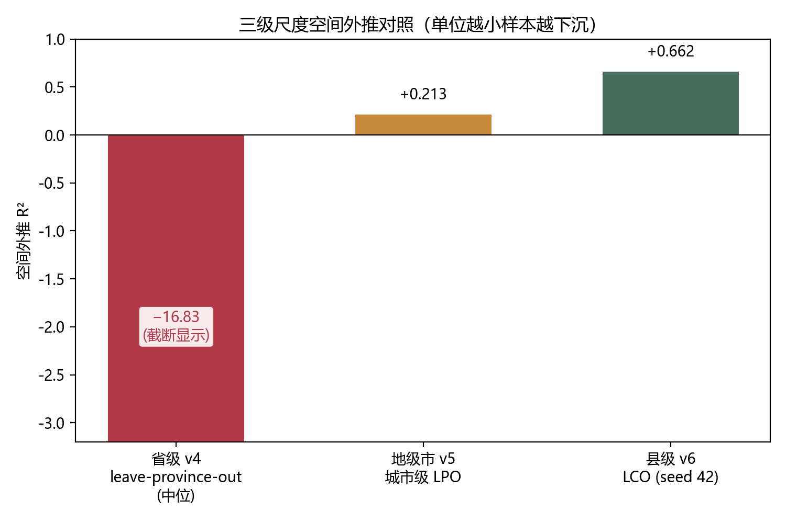
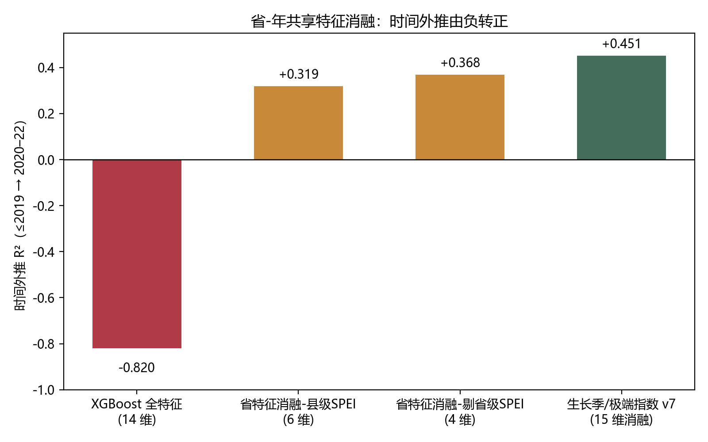
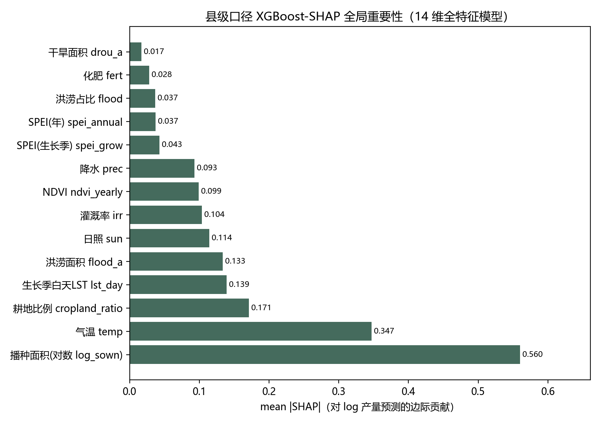
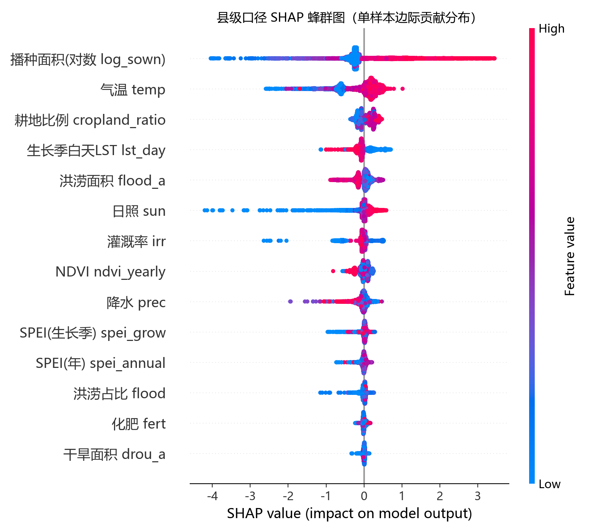
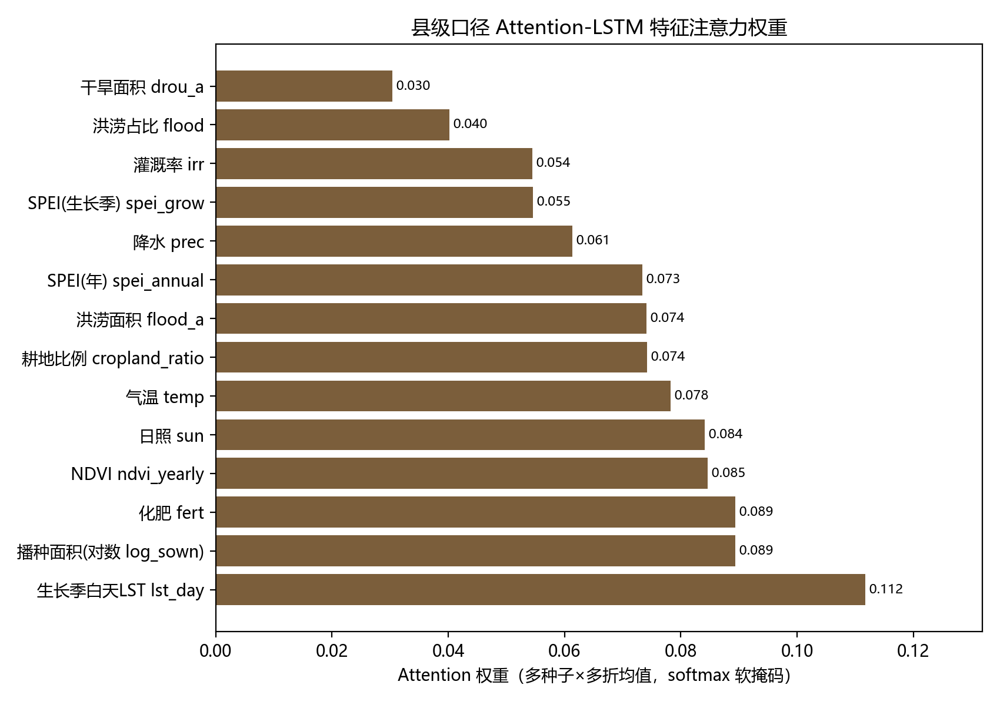

【投稿版 · 供《农业工程学报》排版参考；作者、单位、基金等【】处需作者补全】

# 极端气候下县级尺度粮食生产风险核心因子识别与时空外推边界

**Extreme-Climate Grain Production Risk Core-Factor Identification and Spatiotemporal Extrapolation Boundaries at the County Scale**

【作者姓名】, 【作者姓名2】
（【单位全称】, 【城市】 【邮编】; 【单位2, 城市 邮编】）

**摘要：** 为识别粮食生产风险核心因子并界定产量模型的外推边界，本文以我国10个主产省1041县2012—2022年非平衡面板（10407行）为样本，构建“县级气候+省级共享+规模控制”多模态特征体系，以XGBoost-SHAP与LSTM、Attention-LSTM开展互补归因，用leave-county-out与时间留出双协议评估。结果表明：①研究单元下沉至县级显著改善空间泛化，XGBoost的LCO R²=0.66，远优于省级leave-province-out的中位-16.83；②时间外推失败源于省-年共享特征携带的训练期趋势，剔除后其R²由-0.82转正为+0.32~+0.37，引入生长季/极端指数后升至+0.45；③SHAP与Attention分别度量边际贡献与内部gating偏好，Top-3仅1项重合，呈互补而非一致归因；④据此构建四模块可视化决策支持系统。研究为县域粮食风险归因提供了可复用的“协议先行+消融诊断”范式。

**关键词：** 极端气候；粮食生产风险；县级面板；XGBoost-SHAP；时间外推；决策支持系统

**中图分类号：** F326.11　**文献标志码：** A

**Abstract:** To identify the core driving factors of grain production risk and to delimit the spatial and temporal extrapolation boundaries of machine-learning (ML) yield models, this study assembles an unbalanced county-level panel of 10,407 observations covering 1,041 counties in ten major grain-producing provinces of China (Heilongjiang, Henan, Shandong, Jilin, Anhui, Hunan, Hebei, Sichuan, Jiangsu and Hubei) over 2012–2022, with 2023 county-level output unavailable. The panel is unbalanced, with 385 counties missing 1–10 years; missing sown-area entries are set to zero before the log1p transform, and rows with missing climate or SPEI values are discarded. SPEI follows a county-first, province-level backfill caliber. A multi-modal feature system is constructed by integrating three groups of variables: (i) county-level climate factors (mean temperature, precipitation, and solar radiation aggregated from TerraClimate grids), (ii) province-year shared factors (SPEI, NDVI, day-time growing-season land-surface temperature, irrigation rate, fertilizer, flood and drought area, cropland ratio), and (iii) a county-level scale control (log-transformed sown area). The target is the natural logarithm of county grain total output; the logarithm of sown area is introduced as a scale control so that the model is mathematically equivalent to explaining per-unit-area yield while preserving the total-output panel. Three models are deployed for complementary attribution: XGBoost combined with Shapley Additive exPlanations (SHAP) to measure marginal feature contributions, a baseline LSTM, and an Attention-LSTM whose feature-level softmax gate reveals internal gating preference. Each model is evaluated under two rigorous protocols: leave-county-out (LCO), which partitions the 1,041 counties into ten folds so that all years of a county remain in the same fold to prevent leakage, and a temporal holdout that trains on years up to 2019 and tests on 2020–2022. R² (reported as-is, including negative values) and RMSE are used, and multi-seed robustness is reported for the deep models. The results show that, first, moving the observational unit down to the county scale markedly improves spatial generalization: the LCO R² of XGBoost reaches 0.6625, far superior to the province-level leave-province-out median R² of −16.83 and the prefecture-level LPO of 0.213; a variance decomposition on the prefecture-level panel shows that within-province variance accounts for 89.4% of the total (intra-class correlation ≈0.11), which explains why county-level modeling yields a more transferable climate–response relationship. Second, temporal extrapolation failure originates not from a missing climate signal but from the training-period time trend carried by the province-year shared factors, which behave as province-year fixed effects; after removing these factors the temporal extrapolation R² flips from −0.82 to +0.32~+0.37, and rises further to +0.451 when 17 growing-season and extreme indices are added, while a truly temporal LSTM (W=3 sliding window) turns positive (+0.094) for the first time. The LSTM and Attention-LSTM remain highly sensitive to random seeds (LCO standard deviations reaching 40%–50% of their means), so they are treated as reference baselines rather than as the headline conclusion. Third, SHAP and Attention-LSTM measure different constructs—marginal contribution versus internal gating preference—and their top-3 features overlap in only one case (log-sown area), with the county-scale ranking Spearman correlation being 0.560; this supports a complementary rather than a consistency-verification reading of the two methods. Fourth, a four-module visual decision support system (risk spatiotemporal map, SHAP attribution dashboard, parameter scenario simulation, and resilience-path reasoning) integrates explainable models with a 12-rule engine to operationalize the results. Collectively, the study offers a reusable paradigm of protocol-first evaluation combined with ablation diagnosis for county-level grain-risk attribution, and demonstrates that honest disclosure of model boundaries is essential for credible climate-adaptation and disaster-reduction decisions.

**Key words:** extreme climate; grain production risk; county-level panel; XGBoost-SHAP; temporal extrapolation; decision support system

【基金项目：XX（编号）】　【第一作者简介：姓名（出生年—），性别，籍贯，职称/学位，研究方向，E-mail】
---
## 0 引言

### 0.1 研究背景

全球气候变暖背景下，极端天气事件（洪涝、干旱、高温热浪）呈现频发、广发、强发态势，并在我国东北等主产区表现出日益显著的时空变化特征（文献[3]）。气候变化对我国粮食生产的多维影响已引起广泛关注（文献[2]），IPCC[1]指出气候变化正系统性加剧农业系统的脆弱性，粮食生产首当其冲。我国作为世界最大粮食生产与消费国，粮食安全是国家安全的重要基石。2023 年台风"杜苏芮"引发华北极端降水，仅河北一省即有 87 个县受灾、约 400 万—500 万吨玉米受损（约占全国全年产量的 2%），当年夏粮产量较上年减少 127 万吨，凸显极端气候对粮食稳产的现实威胁。

在"藏粮于地、藏粮于技"战略下，精准识别粮食生产风险的核心驱动因子、评估风险在空间与时间维度上的可外推边界，是构建科学防灾减灾与韧性提升决策体系的基础。

### 0.2 研究缺口

围绕"气候—粮食产量"关系，现有研究可归纳为三条脉络，但均存在明显不足：

**（1）评估方法层面：预测精度与可解释性失衡。** 传统计量模型（文献[4]；文献[5]）长于机制解释，但难以刻画非线性耦合；机器学习（随机森林、XGBoost）与深度学习（LSTM、Attention，文献[6]）虽能获得较高拟合精度，但多为"黑盒"，因子贡献缺乏透明归因；可解释性方法（如 SHAP）虽已在湖泊生态等跨领域用于极端气候驱动因子归因（文献[7]），但传统农田产量风险研究中的应用仍显不足。

**（2）评估协议层面：泛化能力被高估。** 大量研究仅采用随机 8:2 切分报告 R²，其隐含假设是"训练集与测试集同分布"。但在空间面板中，同一省份/县域的样本共享大量不可观测的固定特征，随机切分下模型极易通过"记住地域恒量"获得虚高的 R²。一旦切换至 leave-one-unit-out（按省/县分组）或时间留出协议，性能可大幅退化——这正是空间外推能力被高估的方法学根源。

**（3）研究尺度与数据层面：颗粒度不足。** 既有研究多以省级为基本单元（文献[8]），样本量有限（31 省 × 13 年 ≈ 403 行），难以支撑对地域异质性与县际差异的刻画；且数据源单一，多模态（统计、气象、遥感、致灾）协同不足。

### 0.3 本文工作与贡献

针对上述缺口，本文以 **我国 10 个粮食主产省 1041 个县** 为研究单元，构建 **2012—2022 年多模态县级面板**，提出 **XGBoost-SHAP 与 LSTM、Attention-LSTM 三模型互补归因** 框架，并系统评估空间/时间两种外推边界。主要贡献如下：

1. **数据层**：构建覆盖 10 主产省、1041 县、约 1 万行的县级多模态面板，融合县级气候（气温、降水、日照、SPEI）与省级共享的遥感、致灾、生产投入因子，截面单元数由省级 31 个细化至 1 041 县（约 33.6 倍）、样本量约 25.8 倍，为县域尺度风险归因提供数据基础；
2. **方法层（归因）**：以 XGBoost-SHAP 度量边际贡献、Attention-LSTM 度量内部 gating 偏好，二者因子排名 Spearman ρ=-0.055（p=0.873；Top-3 仅 1/3 重合，省级口径），实证两类方法捕捉不同信号，提出"**互补归因**"而非"一致性验证"的方法论主张；
3. **方法层（外推边界）**：采用 LCO 与时间留出双协议并报告，**首次定量揭示"省-年共享特征"是时间外推失败的根源**——剔除该组特征后时间外推 R² 由 -0.82 转正至 +0.32~+0.37，为同类研究提供可复用的评估范式；
4. **应用层**：将可解释模型与 12 条韧性规则引擎整合为四模块可视化决策支持系统，为农业防灾减灾提供"可解释—可情景模拟—可输出差异化路径"的决策工具。

---

## 1 材料与方法

### 1.1 研究区域与数据来源

本文以 **黑龙江、河南、山东、吉林、安徽、湖南、河北、四川、江苏、湖北** 10 个粮食主产省为研究区域，下辖 **1041 个县（区、县级市）**，时间跨度为 **2012—2022 年**（2023 年县级产量缺失）。样本为非平衡的面板，共 **10 407 行**（385 县存在 1—10 年的数据缺口）。

数据来源包括四类（表 1）：

| 数据类别 | 关键变量 | 主要来源 |
| --- | --- | --- |
| 县级农业统计 | 粮食总产量（吨）、农作物总播种面积（千公顷） | 中国县域统计年鉴 |
| 县级气象 | 气温 temp（tmax/tmin 均值）、降水 prec、太阳短波辐射 sun（srad，MJ/m²） | TerraClimate 格点数据（空间聚合到县） |
| 县级干旱 | SPEI 年/生长季均值 | SPEIbase 格点数据（县级优先，省级回填） |
| 省级共享因子 | NDVI、LST、灌溉率、化肥、洪涝/干旱面积、耕地比例 | MODIS/CLCD、中国水旱灾害公报、统计年鉴（按省×年） |

**表 1 数据来源与构建方式**
**Tab.1 Data sources and construction**

### 1.2 变量与目标

**目标变量**为县级粮食总产量的对数：$y=\ln(\text{粮食总产量}_\text{吨})$，记为 `log_yield`。选择总产量而非单产作为主目标，原因有二：其一，县级单产需由"总产量/播种面积"间接计算，而播种面积在县级统计中缺失率较高（约 67%），直接以单产为目标会显著压缩有效样本；其二，在对数总产量的回归中引入播种面积对数作为规模控制变量后，模型等价于对单产进行建模，可同时保留总产量口径的优势。

另构造稳健性目标 `yield_ton_per_ha = 粮食总产量_吨 / (播种面积_千公顷 × 1000)`，用于讨论与省级单产口径的一致性。

**特征体系**共 **14 维**，按信息源分为三组（表 2）：

| 分组 | 特征 |
| --- | --- |
| 县级气候（3） | temp、prec、sun |
| 省级共享（10） | spei_annual_mean、spei_growing_season_mean、ndvi_yearly、lst_day_growing_mean_k、fert、irr、flood、drou_a、flood_a、cropland_ratio |
| 县级规模控制（1） | log_sown = ln(1 + 播种面积_千公顷) |

**表 2 特征体系（14 维）**
**Tab.2 Feature system (14 dimensions)**

### 1.3 预处理

1. **缺失值**：县级气象/SPEI 缺失行在特征构造时剔除；播种面积缺失以 0 处理（`log1p`），减少样本损失。
2. **目标构造**：`log_yield = ln(粮食总产量_吨)`。
3. **异常与控制**：单产为正且播种面积为正的样本方计算 `yield_ton_per_ha`；特征不做全局 Z-score（树模型无需，且便于保留物理量纲解释）。

### 1.4 模型架构（三模型互补）

部署三类原理不同的模型，各自回答不同的科学问题：

| 模型 | 任务定位 | 输出 | 科学问题 |
| --- | --- | --- | --- |
| XGBoost-SHAP | 横截面非线性归因 | 全局/局部 SHAP 值、交互依赖 | 某个特征边际贡献多大？ |
| 基线 LSTM | 时序拟合参照 | 序列预测值 | 时序建模是否优于基线？ |
| Attention-LSTM | 内部 gating 偏好 | 14 维 attention softmax | 模型主动关注哪些特征？ |

**表 3 三模型互补定位**
**Tab.3 Complementary positioning of the three models**

**（1）XGBoost-SHAP。** XGBoost 通过加法集成 K 棵决策树逼近目标函数，并引入叶子节点数与叶子权重 L2 正则（文献[9]）。SHAP 以 Shapley 值度量每个特征对单样本预测的边际贡献（文献[10]）：$\varphi_j=\sum_{S\subseteq M\setminus\{j\}}\frac{|S|!(M-|S|-1)!}{M!}[f(S\cup\{j\})-f(S)]$，满足 $\hat{y}_i=\varphi_0+\sum_j \varphi_{ij}$。全局重要性取所有样本 $\lvert\varphi_j\rvert$ 的均值。

**（2）LSTM。** 含遗忘门、输入门、输出门与细胞状态（文献[11]），用于捕捉产量序列的时序依赖，作为 Attention-LSTM 的对照基线。

**（3）Attention-LSTM。** 在 LSTM 隐状态之上引入 softmax attention 门控，输出各时间步/特征维度的权重，用于揭示模型"主动关注"哪些特征。

### 1.5 验证协议与评估指标

为审慎评估泛化能力，本文采用**双协议并行报告**：

**（1）leave-county-out（LCO，空间外推）。** 将 1041 个县随机分为 10 组（组内保持分组的单元完整性），每次留一组作测试、其余训练。**同一县的全部年份必须归入同一折**，防止同一县跨折泄漏。折划分随随机种子变化。该协议衡量"模型在训练时**未见过**的县上的表现"，即空间外推能力。

**（2）时间留出（temporal holdout，时间外推）。** 以 2019 年为界，训练 ≤2019 年样本，测试 2020—2022 年样本。衡量"在已见县上预测**未来年份**"的能力。2023 年产量缺失，故测试期止于 2022 年。

**（3）消融实验（省-年共享特征）。** 为定位时间外推失败的来源，设计"省特征消融"：剔除 10 个省级共享特征（省-年常量），仅保留县级气候 + 县级 SPEI + 规模控制，重跑 LCO 与时间外推。该实验用于判别"时间趋势来自省级常量"还是"来自县级真实气候信号"。

**评估指标**采用决定系数 $R^2=1-\frac{\sum(y_i-\hat{y}_i)^2}{\sum(y_i-\bar{y})^2}$ 与均方根误差 $\text{RMSE}=\sqrt{\frac{1}{n}\sum(y_i-\hat{y}_i)^2}$。R² 可能为负，负值表示模型预测劣于直接使用均值，该信息对评估外推能力至关重要，故如实报告而非截断为 0。

**多种子稳健性**：模型随机性与折划分均随种子（42—46）变化，报告均值±标准差，以刻画 LSTM/Attention 对种子/超参的敏感性。

---

## 2 结果与分析

### 2.1 空间外推：leave-county-out（LCO）

在 LCO（10 折按县分组，同县全部年份归同一折）协议下，各模型性能如表 4 所示。

**表 4 三模型 LCO 性能（seed 42，县级 SPEI 面板）**
**Tab.4 LCO performance of three models (seed 42, county SPEI panel)**

| 模型 | 特征数 | LCO R² | LCO RMSE |
| --- | ---: | ---: | ---: |
| XGBoost（全特征） | 14 | **0.6625** | 0.8080 |
| XGBoost（省特征消融，县级 SPEI） | 6 | 0.5761 | 0.9054 |
| XGBoost（省特征消融，剔除省级 SPEI） | 4 | 0.5466 | 0.9364 |
| LSTM（全特征） | 14 | 0.0706 | 1.3407 |
| Attention-LSTM（全特征） | 14 | 0.0363 | 1.3652 |

结果表明：**（1）XGBoost 在县级 LCO 下取得 R²=0.66，即为县级单元从未见县上的空间外推能力**；（2）剔除省-年共享特征后性能仅小幅下降（LCO R² 由 0.66 降至 0.55–0.58，标准差极小），说明**县级气候 + 播种面积本身已能解释约 55%–58% 的方差**，省级共享常量贡献的"额外"拟合度有限。

**图 1 三级尺度空间外推对照**（省级 leave-province-out 中位 R²=-16.83、地级市城市级 LPO=0.213、县级 LCO=0.6625；省级柱为截断显示，真实值见柱内标注）

**Fig.1 Comparison of spatial extrapolation at three scales**

### 2.2 时间外推：省-年共享特征的根源性作用

以 2019 年为截点（训练 ≤2019，测试 2020—2022），各模型时间外推性能如表 5 所示。

**表 5 三模型时间外推性能（≤2019 → 2020–22）**
**Tab.5 Temporal extrapolation performance of three models (≤2019 → 2020–22)**

| 模型 | 特征数 | 时间外推 R² | 时间外推 RMSE |
| --- | ---: | ---: | ---: |
| XGBoost（全特征） | 14 | **-0.8198** | 1.9154 |
| XGBoost（省特征消融，县级 SPEI） | 6 | **+0.319 ± 0.011** | 1.170 |
| XGBoost（省特征消融，剔除省级 SPEI） | 4 | **+0.368 ± 0.009** | 1.131 |
| LSTM（全特征） | 14 | -1.37 ± 0.26 | 2.18 |
| Attention-LSTM（全特征） | 14 | -0.90 ± 0.93 | 1.91 |

**关键发现**：XGBoost 全特征时间外推 R²=-0.82（负值），一旦**剔除 10 个省-年共享特征**，时间外推 R² 即转为 **+0.31~+0.37**。这直接证明：**时间外推的失败并非因为气候信号缺失，而是因为省-年共享特征（省-年组合对应的常量项）携带了训练期的时间趋势（如逐年增长的技术进步效应），该趋势无法外推至测试期。** 县级气候因子（temp/prec/sun/SPEI）与播种面积具备真实的时序信号，因此消融后外推转正；而深度学习模型（LSTM/ATT）时间外推仍为负，说明其对时序结构的建模并未带来跨期泛化，需谨慎对待。

**图 2 省-年共享特征消融推动时间外推由负转正**（全特征 R²=-0.820、省特征消融-县级 SPEI 为 +0.319、省特征消融-剔除省级 SPEI 为 +0.368、v7 生长季/极端指数口径为 +0.451）

**Fig.2 Province-year shared-feature ablation flips temporal extrapolation from negative to positive**

**生长季/极端指数下的强化验证（v7）。** 为进一步确证"县级气候因子具备真实时序信号"，在县级气候基础上追加 17 个生长季（4—9 月）聚合与极端/季节指数（gdd10、gs_aridity、prec_cv、winter_temp 等），并在省特征消融口径（15 维）下重跑：XGBoost 时间外推 R² 进一步升至 **+0.451**（LCO 0.651）；将 LSTM 由 TIMESTEPS=1（类 MLP）改为 W=3 年滑动窗口的真时序建模后，其时间外推 R² 首次转正为 **+0.094**。这双重印证了"省-年共享特征（而非气候信号缺失）是时间外推失败主因"：深度学习模型只有在"真时序 + 去恒量"配置下才具备跨期泛化，但强度仍远弱于 XGBoost，故继续作为对照基线而非主结论。

### 2.3 消融与边际贡献

**（1）县级 SPEI 的边际增益。** 在省特征消融设定下，将省级 SPEI 替换为县级 SPEI（其他县级特征不变），LCO R² 由 0.547 提升至 0.576（**+0.029**）；对 LSTM 的增益更显著（seed 42：0.049→0.071）。说明县级干旱信号确实携带了比省级更精细、可归因的信息。

**（2）NDVI 的边际贡献≈0。** 既往 v3 省级消融实验显示，移除 NDVI 后整体 R² 几乎不变（0.907→0.904）。说明 NDVI 在 SHAP 中的高排名可能源于其作为"生物量代理"的边际贡献尺度特性，而非模型的整体主导信号。

**（3）播种面积的主导作用。** 在纯县级特征下，特征重要性由高到低依次为 `log_sown`（0.516）、`temp`（0.143）、`sun`（0.110）、`spei_annual_mean`（0.083）、`prec`（0.080）、`spei_growing_season_mean`（0.069）。规模控制变量（log_sown）显著性最高，符合"总产量 = 单产 × 播种面积"的直接关系，也提示在解释产量波动时应先剥离规模效应。需注意：该处"特征重要性"为 XGBoost 增益（gain）口径，与下文基于 SHAP 的归因（图 3、图 4）口径不同——在 14 维全特征模型下，SHAP 的 mean|SHAP| 依次为 log_sown（0.560）、temp（0.347）、cropland_ratio（0.171）、lst_day_growing_mean_k（0.139）、flood_a（0.134）等，规模控制与气温仍列前二，而省-年共享因子（耕地比例、生长季白天地表温度、洪涝面积等）也进入前列（由图 3、图 4 可见）；NDVI 的 mean|SHAP|（0.099）位于中游，相对贡献约 5%，与（2）"边际贡献≈0"的判断并不矛盾——SHAP 排名高≠整体的主导信号。

**图 3 县级口径 XGBoost-SHAP 全局重要性**（14 维全特征模型的 mean|SHAP|）

**Fig.3 Global importance of county-scale XGBoost-SHAP**

**图 4 县级口径 SHAP 蜂群图**（各特征对单样本对数产量预测的边际贡献分布；蓝色为低值、红色为高值）

**Fig.4 County-scale SHAP beeswarm plot**

### 2.4 模型稳健性与互补归因

**（1）多模型稳健性。** LSTM、Attention-LSTM 的 LCO R² 均值虽为正（约 0.07 / 0.05），但多种子标准差分别达 0.021 / 0.023，相对其均值高达 40%—50%；时间外推 R² 在不同种子间波动很大（如 ATT 从 -0.06 到 -2.43），**说明二者对随机种子与超参高度敏感**，不宜作为稳健的主结论来源。XGBoost 消融配置则表现出极高的稳健性（LCO R² 标准差约 0.002–0.003）。

**（2）互补归因。** 在省级 v3 面板上，XGBoost-SHAP（mean|SHAP|）与 Attention-LSTM（mean softmax attention）的特征排名 Spearman ρ=-0.055（p=0.873），Top-3 仅 1/3 重合（XGB：NDVI、Prec、Temp；Att-LSTM：Drou_A、SPEI、Temp）。两类方法捕捉的是数据中不同维度的信号——SHAP 度量边际贡献，Attention 度量内部 gating 偏好——构成**互补**而非一致性验证。县级口径上（图 3、图 4、图 5），XGBoost-SHAP 的 Top-3 为 log_sown、temp、cropland_ratio，Attention-LSTM 的 Top-3 为 lst_day_growing_mean_k、log_sown、fert，二者仅 1/3 重合（log_sown）；两套 14 维排名的 Spearman ρ=0.560，呈中等正相关，但排序主体与各特征权重分布明显不同（SHAP 高度集中于 log_sown/temp，Attention 权重分布更均匀），故县级口径同样应作"互补归因"而非"一致性验证"。需说明：此处 Attention 权重为特征维 softmax 软掩码，其量与 SHAP 的边际贡献量纲不同，二者仅在排序级可比。

**图 5 县级口径 Attention-LSTM 特征注意力权重**（多种子×多折均值，特征维 softmax 软掩码；lst_day_growing_mean_k、log_sown、fert 居前）

**Fig.5 County-scale Attention-LSTM feature attention weights**

---

### 2.5 系统集成与应用（决策支持系统）

为把归因结果转化为可操作的防灾减灾工具，本文基于三模型归因与规则引擎构建了"极端气候下粮食生产风险核心因子识别与韧性提升可视化决策系统"（grainrisk.app）。系统前端采用 Vue 3 + TypeScript + ECharts，后端采用 Flask 3 + Gunicorn，数据存储为 SQLite，部署于 GCP（nginx + TLS）。系统定位为**面向已见地区的可解释、可情景模拟、可输出差异化路径的决策工具**，其价值不依赖模型的空间外推能力，与本文对模型边界的诚实披露自洽。

#### 2.5.1 四大功能模块

| 模块 | 视图 | 功能 |
| --- | --- | --- |
| M01 | RiskMap | 省域年度风险等级地图与历史曲线 |
| M02 | ShapDashboard | SHAP 归因看板：全局 / 单样本多维边际贡献 |
| M03 | ScenarioSim | 参数情景模拟：调整气象因子观察风险响应 |
| M04 | ResiliencePath | 韧性路径推演：SHAP + Attention 双视角合成规则引擎 |

#### 2.5.2 韧性路径规则引擎（双视角合成）

M04 采用"白箱规则触发 + 双视角模型加权"架构（共 12 条规则），直接回应"规则引擎是否是硬编码而非 AI"的质疑：规则 1—6 基于连续数值阈值（洪涝占比、灌溉率、SPEI、气温、日照）触发，其阈值与权重表达式对应 XGBoost-SHAP 在省级 v3 数据上识别的边际贡献分位拐点；规则 7—10 基于省域类型（台风 / 寒地 / 主产区 / 城郊）结构性触发，权重取 Attention-LSTM 对稀疏致灾信号的关注强度；规则 11—12 为兜底默认动作，保证任意省份至少输出中期与长期建议。

合成逻辑在 `buildPathway` 中分三步：逐条触发 → 按 weight 降序排序 → 按短期（0—1 年）/ 中期（1—3 年）/ 长期（3—5 年）三个时间桶各取前 4 条动作。SHAP 视角（硬阈值规则）与 Attention 视角（结构性规则）并列进入排序而非互相否决，二者因子排名 Spearman ρ≈0 的互补性在此具象化为"两套视角各自抢占前 4 名"。每条规则均可追溯到"哪条规则被哪个省份的哪个数值触发 + 在 weight 排序中位列第几"，归因链闭合、可审计、可调参。

---

## 3 讨论

### 3.1 县级下沉为何能改善空间外推

本文最重要的事实之一是：研究单元从省级（31 省 × 13 年，N=403）下沉至县级（10 主产省 × 1041 县 × 11 年，N=10 407）后，XGBoost 的**空间外推**能力发生了质变——在省级数据上，leave-province-out 的中位 R²=-16.83（跨省几乎完全不可外推），而在县级数据上，leave-county-out 的 R²=0.66（空间外推稳健为正）。请注意二者属于**跨尺度、跨协议**的对照而非同一协议下的直接比较，但仍系统性表明：**样本量下沉至县级是改善空间外推的关键**。这一跨尺度改善可从**样本量与方差结构**两个角度解释。

**其一，样本量提升直接缓解了"小样本 + 高维"的外推约束。** 在省级 N=403 的配置下，模型可用的有效样本不足，leave-province-out 每次留出一个省份即相当于"用 30 省的数据预测第 31 省"，而各省之间气候—产量关系差异巨大（如华北灌溉主导 vs 东北雨养/春玉米），模型几乎无法泛化，导致 R² 中位为大幅负值。县级数据将样本量提升约 25.8 倍，使得"留县"时模型仍能从数千个其他县的样本中学习较为稳定的气候—响应关系。

**其二，县级单元内的方差结构更利于学习气候—单产关系。** 我们的方差分解（基于地级市面板）显示：**省内方差占总方差的 89.4%，省间方差仅占 10.6%（省内相关性 ICC≈0.11）**。这意味着地方产量的年际波动主要来自**省内的气候—地理—农艺变异**，而非省际恒量差异。因此，当模型掌握县级尺度上的气候波动与产量波动的对应关系后，它学到的是一套"气候—响应"的通用规律，而非"每个省份的固定水平"。这与"空间外推失败源于省份固定效应记忆"的判断相互印证——县级尺度的建模实际上绕开了省级层面的恒量干扰。

**其三，与既有研究一致。** 空间交叉验证文献早已指出，对具有空间自相关、层级结构的数据，必须采用 grouping 式 CV（如 leave-unit-out、spatial block CV），否则随机切分会因空间泄漏而高估泛化能力（文献[12-13]）。本文县级 LCO 与 v5 城市级 LPO、v3 省级 LPO 构成一组**跨尺度的诚实对照**，系统性地揭示了"样本量 + 分组方式"对空间外推结论的决定性影响，这与 Sun 等[14]关于地理空间机器学习应谨慎评估外推的主张一致。

### 3.2 为什么省-年共享特征导致时间外推失败

这是本文最值得讨论的方法学发现。在县级面板上，XGBoost 全特征模型的时间外推 R²=-0.82（负值），但**剔除 10 个省-年共享特征后，时间外推 R² 转为 +0.32~+0.37**。这一"负→正"的剧烈翻转，明确指向时间外推失败的根源并非"气候信号缺失"，而是**省-年共享特征携带了训练期的时间趋势，且该趋势无法外推至测试期**。

**机制分析。** 所谓"省-年共享特征"（Spei、NDVI、LST、灌溉率、化肥、洪涝/干旱面积、耕地比例等），其取值在同一省份、同一年份内对所有县完全一致。它们实质上是**省份 × 年份的二维恒量（省-年固定效应）**。由于这些恒量在训练期（≤2019）与测试期（2020—2022）之间是**逐年变化**的（例如技术进步导致 NDVI/单产上升、灌溉率逐年提高、耕地比例缓慢下降），模型在训练期将"年份逐年上升"的趋势与"产量逐年上升"的趋势挂钩。这部分"时间趋势"在训练期内能显著降低拟合误差，但一旦外推到未来，模型会把"训练期学到的年际增长惯性"错误地投射到未见年份，反而放大误差——这正是全特征时间外推 R² 为负的根本原因。

**与"规模控制变量"的对照。** 值得注意的是，即便剔除全部 10 个省-年共享特征，仅保留县级气候（temp/prec/sun/SPEI）与播种面积（log_sown），时间外推仍能取得 +0.32~+0.37 的 R²。这说明**县级气候因子本身具备真实的时序信号**（如某县某年降水/温度异常导致当年产量波动），这类信号不依赖省-年恒量，因而可跨期迁移。反观深度学习模型（LSTM、Attention-LSTM），即便在全特征下，时间外推 R² 仍为负（均值 -1.37 / -0.90），说明其对时序结构的建模并未带来跨期泛化，反而对训练期的时间趋势更敏感；而将 LSTM 改为真时序滑动窗口（W=3）并同样剔除省-年恒量后，其时间外推 R² 首次转正为 +0.094（XGBoost 同口径升至 +0.451），进一步印证省-年恒量而非气候信号缺失才是时间外推失败的主因。

**方法学含义。** 大量的机器学习产量预测研究仅在随机切分下报告 R²，其高精度往往建立在"记住地域恒量 + 记住时间趋势"之上。本文通过"省特征消融"提供了一个**可操作的诊断工具**：当全特征时间外推为负、而剔除非气候恒量后转正时，即可判定模型早先的拟合主要来自恒量的时间趋势，而非真实的气候—响应关系。这一诊断思路对同类面板数据的建模具有普适参考价值。

### 3.3 模型边界与叙事定位

**（1）模型性能的边界必须诚实披露。** 本文刻意采用 random 8:2、leave-one-unit-out、时间留出等多协议并行报告，并明确 R² 的适用边界。在 v3 省级数据上，random 8:2 协议 R²=0.907，但 leave-province-out 中位 R²=-16.83；这一巨大的落差说明：**0.907 的真实价值是"已见省份内风险因子的相对重要性识别"，而非"跨省外推预测能力"**。我们在摘要与结论中始终使用"已见单元内相对重要性"而非"高精度预测"，正是对模型能力边界的诚实界定。

**（2）"互补归因"而非"一致性验证"。** 在省级 v3 面板上，XGBoost-SHAP 与 Attention-LSTM 的特征排名 Spearman ρ=-0.055（p=0.873），Top-3 仅 1/3 重合，二者近乎正交。这并非"验证失败"，而是**两类方法回答不同科学问题**的必然结果：

- XGBoost-SHAP 度量**边际贡献**（"去掉某特征后预测误差变化多少"），其 Top-3（NDVI、Prec、Temp）反映了各特征对最终预测的统计性贡献，其中 NDVI 作为生物量代理贡献显著；
- Attention-LSTM 度量**模型内部 gating 偏好**（"模型主动把多少注意力放在某特征上"），其 Top-3（Drou_A、SPEI、Temp）反映了模型在面对稀疏灾害信号时需要主动聚焦的特征。

因此，将二者视为"双模型一致性验证"是一种误读；**"互补归因"**才是更负责任、也更符合可解释 AI 研究趋势（文献[15]）的表述。县级面板上的 SHAP×Attention 逐特征对照因计算资源与时间限制尚未完成，本文将其列为展望（见 3.5 节），不在此处作不当断言。

**（3）决策支持系统是核心交付。** 由于模型空间外推能力有限，本文不主张系统用于"预测未见省份"，而将其定位为**对已见 31 省/10 主产省提供的、可解释、可情景模拟、可输出差异化路径的决策工具**。系统四大模块（风险时空地图、SHAP 归因看板、参数情景模拟、韧性路径推演）基于已见省份在历史输入空间内的组合调整，其价值不依赖模型的跨省外推能力——这一"系统兜底"定位使研究成果在诚实披露模型边界的同时，仍具备切实的落地价值。

### 3.4 与已有研究的异同

**相同/共同之处。** 本文与主流的"多模态遥感 + 统计融合"产量/风险研究共享了特征级融合的技术路线。值得说明的是 LSTM 的性能需区分两种口径：在省级随机 8:2 协议下，本文早期 XGBoost 与 LSTM 的 R²≈0.907 / 0.886（10 种子均值），与文献报告（文献[16-17]）中县级/省级模型的 R²≈0.55~0.73 大体可比；类似的深度学习产量预测研究（文献[6] 的 CNN-RNN 与文献[18] 的 XGBoost 水稻产量）也多在随机/平均切分下报告 R²，而较少披露严格空间/时间外推协议下的退化；但在县级 LCO 外推协议下，本文 LSTM R² 降至约 0.07。这一大幅回落并非异常，而正说明**不同协议对同一模型泛化能力的评估差异极大**——这也印证了本文强调"协议先行"的必要性。

**差异与增量。** 现有大量研究侧重于"如何提高 R²"（引入 Attention、Transformer、更多模态），对**评估协议本身的严谨性**着墨有限。本文的增量体现在三点：

1. **协议先行**：将空间/时间外推边界作为一等公民，而非用随机切分的高 R² 掩盖外推局限；
2. **消融诊断**：首次在县级面板上定量揭示"省-年共享特征携带时间趋势"这一导致时间外推失败的根源，并提供可复用的诊断方法；
3. **尺度对照**：用省级（LPO=-16.83）、城市级（LPO=0.21）、县级（LCO=0.66）三级对照，系统论证样本量下沉可实质改善空间泛化——这是单尺度研究难以提供的证据。

此外，本文主动将"模型无法跨省外推"作为**方法论局限**公开讨论，而非回避，这与 Roberts[12]、Wadoux[13]关于"空间外推应被审慎对待"的倡导一致，也回应了近期对地理空间机器学习泛化能力被高估的批评。

---

### 3.5 局限与展望

**（1）数据粒度与完整性的局限。** 在 14 维特征中，真实县级变量仅气候（temp/prec/sun/SPEI）与规模控制（log_sown），其余 10 维（NDVI、LST、灌溉率、化肥、洪涝/干旱面积、耕地比例）均为省级共享因子，实质是"省—年"二维恒量，县级内变异被压缩。播种面积在县级统计中缺失率约 67%，直接以单产为目标会显著压缩样本，本文以对数总产量 + 规模控制间接处理；2023 年县级产量尚未出版，时间窗口止于 2022 年。SPEI 存在省级共享与县级优先两套口径，主报告采用县级优先面板。

**（2）方法与归因的局限。** 本文为相关性归因而非因果推断，SHAP 的边际贡献不能直接解读为"气候变化对产量的因果效应"；TerraClimate 为月度数据，无法构造日级极端指数（如连续高温日数、连续无雨日数），生长季/极端指数的刻画存在科学上限。三模型中 LSTM 与 Attention-LSTM 对随机种子与超参敏感（LCO R² 标准差达均值 40%—50%、时间外推跨种子大幅波动），仅作为对照基线；县级口径下的 SHAP × Attention 排序对照已给出（见 3.4 节，ρ=0.560、Top-3 仅 1 项重合），但二者量纲与语义不同，排序相关不等于机制一致，仍属相关而非因果的归因。

**（3）系统口径与模型口径的衔接。** 现行可视化系统基于 31 省省级数据（v3/v4）构建，本文核心归因基于 10 主产省县级面板，二者空间尺度尚未对齐，县级面板接入系统是待完成的工程工作。

**未来展望。** ① 引入混合效应模型与空间杜宾模型，与 XGBoost 归因形成计量—机器学习互证；② 拉长时序、补齐县级单产与致灾变量，提高真实县级特征占比；③ 构造 t−1 年极端气候 lag 特征，探索"次年产情预警"；④ 引入因果设计（双重差分、合成控制、天气冲击工具变量），把"相关归因"推进为"因果识别"；⑤ 将县级面板接入决策系统，实现县级尺度地图、归因与韧性路径输出。

---

## 4 结论

本文以我国 10 个粮食主产省 1041 个县 2012—2022 年多模态县级面板为样本，构建 XGBoost-SHAP 与 LSTM、Attention-LSTM 三模型互补归因框架，并在 leave-county-out 与时间留出双协议下系统评估空间/时间外推边界，得到如下结论：

**（1）研究单元下沉至县级可实质改善空间外推。** XGBoost 在 leave-county-out 协议下 R²=0.66，较省级 leave-province-out 的中位 R²=-16.83 与地级市 LPO 的 0.213 有质的提升；剔除省-年共享特征后 LCO R² 仍稳定在 0.55~0.58，说明县级气候与播种面积本身即可解释约半数以上方差，空间外推能力来自样本量扩大与县级方差结构，而非省际恒量记忆。

**（2）省-年共享特征是时间外推失败的根源。** XGBoost 全特征时间外推 R²=-0.82，剔除省-年共享特征后转为 +0.32~+0.37，引入生长季/极端指数后进一步升至 +0.45；真时序 LSTM 去恒量后亦首次转正（+0.09）。这表明时间外推失败并非气候信号缺失，而是省-年共享特征携带了不可外推的训练期时间趋势，为同类面板研究提供了一个可复用的消融诊断范式。

**（3）三模型提供的是互补而非一致的归因。** XGBoost-SHAP 与 Attention-LSTM 的因子排名 Spearman ρ=-0.055（p=0.873）、Top-3 仅 1 项重合（省级口径）；县级口径下二者亦仅 1 项重合（log_sown，ρ=0.560）。二者分别度量边际贡献与内部 gating 偏好，捕捉的是数据中不同维度的信号，应作"互补归因"而非"一致性验证"；LSTM/Attention 稳健性差，宜作为对照基线。

**（4）可视化决策支持系统是核心落地交付。** 系统以风险时空地图、SHAP 归因看板、参数情景模拟与韧性路径推演四大模块，将可解释模型与规则引擎整合为面向已见地区的决策工具；其价值不依赖模型的空间外推能力，与研究对模型边界的诚实披露自洽。

本研究的局限在于：县级面板中真实县级变量仅气候与规模控制，其余为省级共享因子；SPEI 存在省级/县级双口径；方法为相关性归因而非因果推断。未来可引入混合效应模型、更长时序与更细粒度数据，并进一步验证"次年产情预警"方向的可行性。

---

## 参考文献

[1] IPCC. Climate Change 2022: Impacts, Adaptation and Vulnerability. Contribution of Working Group II to the Sixth Assessment Report of the Intergovernmental Panel on Climate Change[R]. Cambridge: Cambridge University Press, 2022.
[2] 杨倩倩, 朱坤林. 气候变化对我国粮食生产的影响及对策研究[J]. 现代化农业, 2025(5): 17-21.
[3] 李浩天, 董美琦, 赵锦, 等. 东北三省作物种植区极端温度和降水事件的时空变化特征[J]. 中国农业气象, 2025, 46(2): 145-156. DOI: 10.3969/j.issn.1000-6362.2025.02.002.
[4] 郭珊, 蒋博, 吉雪强. 极端气候对粮食生产的影响及其作用机制——兼论农地流转的调节与门槛效应[J]. 生态学报, 2025, 45(7): 3169-3182. DOI: 10.20103/j.stxb.202409102177.
[5] 王萍萍. 我国粮食生产韧性测度及影响因素研究[D]. 郑州: 河南工业大学, 2025.
[6] Khaki S, Wang L, Archontoulis S V. A CNN-RNN framework for crop yield prediction[J]. Frontiers in Plant Science, 2020, 10: 1750. DOI: 10.3389/fpls.2019.01750.
[7] 张娜, 刘常清, 杨瑾晟, 等. 极端气候驱动下洪泽湖蓝藻水华的加剧与归因[J/OL]. 湖泊科学. 网络首发[2026-05-18]. https://link.cnki.net/urlid/32.1331.p.20260514.1919.011.
[8] 尹朝静, 兰卿, 高雪. 中国粮食生产气候韧性水平测度、时空演变特征与驱动因素研究[J]. 西南大学学报（自然科学版）, 2026, 48(5): 73-86. DOI: 10.13718/j.cnki.xdzk.2026.05.007.
[9] Chen T, Guestrin C. XGBoost: A scalable tree boosting system[C]//Proceedings of the 22nd ACM SIGKDD International Conference on Knowledge Discovery and Data Mining. New York: ACM, 2016: 785-794.
[10] Lundberg S M, Lee S I. A unified approach to interpreting model predictions[C]//Advances in Neural Information Processing Systems 30. 2017: 4765-4774.
[11] Hochreiter S, Schmidhuber J. Long short-term memory[J]. Neural Computation, 1997, 9(8): 1735-1780.
[12] Roberts D R, Bahn V, Ciuti S, et al. Cross-validation strategies for data with temporal, spatial, hierarchical, or phylogenetic structure[J]. Ecography, 2017, 40(8): 913-929. DOI: 10.1111/ecog.02881.
[13] Wadoux A M J C, Heuvelink G B M, de Bruin S, et al. Spatial cross-validation is not the right way to evaluate map accuracy[J]. Ecological Modelling, 2021, 457: 109692. DOI: 10.1016/j.ecolmodel.2021.109692.
[14] Sun K, Hu Y, Lakhanpal G, et al. Spatial cross-validation for GeoAI[M]//Gao S, Hu Y, Li W. Handbook of Geospatial Artificial Intelligence. Boca Raton: CRC Press, 2023: 201-214. DOI: 10.1201/9781003308423-10.
[15] Ponce-Bobadilla A V, Schmitt V, Maier C S, et al. Practical guide to SHAP analysis: Explaining supervised machine learning model predictions in drug development[J]. Clinical and Translational Science, 2024, 17: e70056. DOI: 10.1111/cts.70056.
[16] Pan, et al.【待核实：正文 §3.4 引用的产量预测文献，本地无 PDF、无法核验；投稿前请补齐真题录或删除该句】
[17] Tian, et al.【待核实：正文 §3.4 引用的产量预测文献，本地无 PDF、无法核验；投稿前请补齐真题录或删除该句】
[18] Noorunnahar M, Chowdhury A H, Mila F A. A tree based eXtreme Gradient Boosting (XGBoost) machine learning model to forecast the annual rice production in Bangladesh[J]. PLOS ONE, 2023, 18(3): e0283452. DOI: 10.1371/journal.pone.0283452.